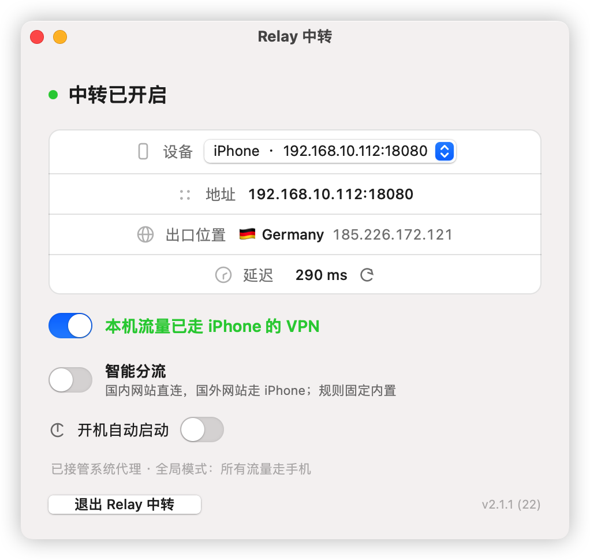
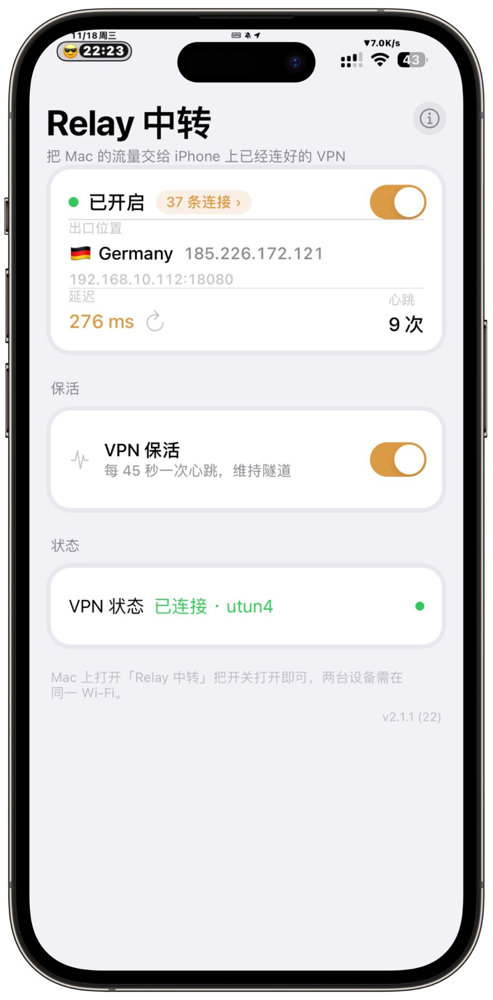

# Relay 中转 · 让电脑用上手机的 VPN

[](https://github.com/DeeJayX/relay/releases/latest)
[](#系统要求)
[](#原理)

**手机连着 VPN，同一个 Wi-Fi 下的电脑就能直接借它出网。**
电脑上不用装 VPN，不用装代理软件，不用改路由，也不用开热点。

<p align="center">
  
  &nbsp;&nbsp;&nbsp;
  
</p>
<p align="center"><sub>左：电脑端（macOS）　右：手机端（iPhone）</sub></p>

**[⬇ 下载最新版](../../releases/latest)**

---

## 手机开热点不行，为什么这个可以

VPN 只接管**本机进程发起的连接**。

开热点时，电脑的流量在手机看来是「转发流量」——从外面进来、再发出去，不经过本机进程，所以绕不进隧道。这就是「手机挂了梯子、开热点给电脑」通常完全没效果的原因。

Relay 换了个方向：**在手机上跑一个服务，替电脑发起连接**。它用的是普通 socket，属于本机进程，会被系统路由自动送进 VPN，出口自然就是 VPN 的出口。电脑端只要把系统代理指向手机。

---

## 三步开始

1. **手机**：连上 VPN → 打开「Relay 中转」→ 开关拨到开。
2. **电脑**：连同一个 Wi-Fi → 打开客户端，手机会自动出现在设备列表里。
3. **电脑**：开关拨到开，完成。

面板上会实时显示当前出口 IP、归属地和端到端延迟，一眼能确认流量真的过去了。

macOS 从菜单栏操作（左键开关、右键面板）；Windows 双击 exe 打开原生窗口，托盘常驻。

---

## 系统要求

手机端和电脑端可以**任意组合**，不要求同一品牌：iPhone 配 Windows、安卓配 Mac 都行。

| 端 | 要求 |
|---|---|
| iPhone | iOS 15 或更高 |
| Android | Android 8.0 或更高 |
| macOS | macOS 11 或更高（Apple 芯片） |
| Windows | Windows 10 / 11（64 位） |

两台设备需要在同一个局域网里。

---

## 特性

- **只要同一个局域网** —— 不用数据线、不用热点、不用动路由器
- **一键接管系统代理** —— 浏览器和客户端立刻生效，不用逐个配置
- **智能分流** —— 内置国内域名规则，国内直连、其余走手机；也可以一键切全局
- **掉线自愈** —— Wi-Fi 抖动不会立刻断，手机回来自动接回
- **退出即还原** —— 关掉就把系统代理恢复原样，不给电脑留坑
- **状态可见** —— 出口 IP / 归属地、端到端延迟、实时连接数
- **四端一套协议** —— 手机是 iPhone 还是安卓、电脑是 Mac 还是 Windows，随便配

---

## 原理

```
电脑应用 → 系统代理 → 电脑本地转发 → SOCKS5 → 手机 → VPN 隧道 → 互联网
```

手机端是一个 SOCKS5 服务；电脑端是一个本地转发层，把系统代理的 HTTP 请求转成 SOCKS5 发给手机（因为 macOS 的 PAC 和 Windows 的 WinINET 只实现到 SOCKS4，而手机只说 SOCKS5）。

域名原样交给手机解析，电脑不预先解析——否则分流规则和 DNS 都会错。

---

## 下载

到 [Releases](../../releases/latest) 取对应平台：

| 平台 | 文件 | 说明 |
|---|---|---|
| iPhone | `Relay-2.1.1.ipa` | 自签安装需带 Network Extension 权限 |
| Android | `Relay-2.1.1.apk` | 直接侧载 |
| macOS | `Relay-2.1.1-macos.dmg` | 拖进「应用程序」 |
| Windows | `Relay-2.1.1-windows.exe` | 单文件，双击即用 |

四个端是同一个版本。

macOS 首次打开若提示「已损坏，无法打开」，是 ad-hoc 签名导致的，执行一次即可：

```bash
xattr -dr com.apple.quarantine "/Applications/Relay 中转.app"
```

---

本仓库只做**编译产物的分发**，不包含源代码。
